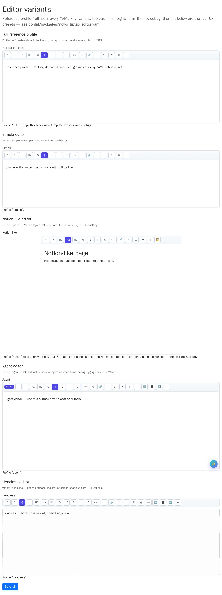

# Tiptap Editor Bundle

[](https://github.com/nowo-tech/TiptapEditorBundle/actions/workflows/ci.yml) [](https://packagist.org/packages/nowo-tech/tiptap-editor-bundle) [](https://packagist.org/packages/nowo-tech/tiptap-editor-bundle) [](LICENSE) [](https://php.net) [](https://symfony.com) [](https://github.com/nowo-tech/TiptapEditorBundle) [](#tests-and-coverage)

> **Found this useful?** [Install from Packagist](https://packagist.org/packages/nowo-tech/tiptap-editor-bundle) · Star the repo on [GitHub](https://github.com/nowo-tech/TiptapEditorBundle).

**Symfony form type** for rich text using [**Tiptap**](https://tiptap.dev/) (ProseMirror). Stores HTML in the underlying textarea — comparable to embedding **CKEditor-style** WYSIWYG fields. Assets are built with **Vite** (IIFE bundle in `Resources/public/`).
**FrankenPHP demos:** runtime is selected with **`FRANKENPHP_MODE`** (`worker` default, or `classic` for per-request PHP / hot-reload). See [docs/DEMO-FRANKENPHP.md](docs/DEMO-FRANKENPHP.md).


This bundle is **FrankenPHP worker mode friendly**.

## Features

- `TiptapEditorType` extending `TextareaType` — value is HTML string.
- Optional formatting toolbar (bold, italic, bullet/ordered lists, undo/redo); **`notion`** variant adds bubble/floating menus (link, image, embed iframe).
- Twig themes aligned with common Symfony layouts (Bootstrap 3–5, Foundation, Tailwind 2, table layout).
- `nowo_tiptap_editor_asset_path()` / `nowo_tiptap_editor_asset_package()` Twig helpers for the Symfony asset package `nowo_tiptap_editor`.
- **pnpm + Vite** frontend; **Vitest** on the bundle logger and the widget lifecycle (custom element).
- **Form submit:** before POST, the bundle syncs ProseMirror HTML into each hidden Symfony textarea (capture-phase `submit`); see [Usage](docs/USAGE.md).
- **Dockerfile + Makefile** workflow matching other Nowo bundles.
- **Demo**: Symfony 8 under `demo/symfony8` (FrankenPHP; `FRANKENPHP_MODE=worker` by default).
- **FrankenPHP worker** safe with the kernel not reset between requests; see the [worker audit](docs/FRANKENPHP-WORKER-AUDIT.md).

## Quick start

```bash
composer require nowo-tech/tiptap-editor-bundle:^1.0
php bin/console assets:install public
```

In Twig layout:

```twig
<script src="{{ asset(nowo_tiptap_editor_asset_path('tiptap-editor.js'), nowo_tiptap_editor_asset_package()) }}"></script>
```

```php
use Nowo\TiptapEditorBundle\Form\TiptapEditorType;

$builder->add('article', TiptapEditorType::class, ['label' => 'Article']);
```

## Demo preview

**Editor variants** in the Symfony demo app (profiles from `config/packages/nowo_tiptap_editor.yaml`: full reference, `simple`, `notion`, `agent`, `headless`). Start the demo with `make -C demo up-symfony8`, then open the **Variants** route in the browser.



Playwright e2e: `make -C demo/symfony8 test-e2e`; refresh the README screenshots with `make -C demo/symfony8 demo-screenshots` (see [CONTRIBUTING](docs/CONTRIBUTING.md#end-to-end-tests-and-screenshots-req-demo-013)).

## Development

Requirements: Docker (recommended), or PHP 8.2+ with Composer + pnpm locally.

```bash
make up           # composer + pnpm install in container
make assets       # vite build → src/Resources/public/tiptap-editor.js
make test         # PHPUnit
make test-ts      # Vitest + coverage (logger)
make qa           # cs-check + phpunit
make demo-smoke   # REQ-TEST-011: FrankenPHP demo HTTP 200
```

Demos:

```bash
make -C demo up-symfony8
# http://localhost:8011
```

## Documentation

- [Installation](docs/INSTALLATION.md)
- [Configuration](docs/CONFIGURATION.md)
- [Usage](docs/USAGE.md)
- [Contributing](docs/CONTRIBUTING.md)
- [Code of Conduct](CODE_OF_CONDUCT.md)
- [Changelog](docs/CHANGELOG.md)
- [Upgrading](docs/UPGRADING.md)
- [Release](docs/RELEASE.md)
- [Security](docs/SECURITY.md)
- [Engram](docs/ENGRAM.md)
- [Spec-driven development](docs/SPEC-DRIVEN-DEVELOPMENT.md)
- [GitHub Spec Kit](docs/SPEC-KIT.md)

### Additional documentation

- [PSR evaluation (REQ-CS-007)](docs/PSR.md)
- [Demo with FrankenPHP (development and production)](docs/DEMO-FRANKENPHP.md)
- [FrankenPHP worker audit (kernel not reset)](docs/FRANKENPHP-WORKER-AUDIT.md)
- [GitHub Actions CI requirements](docs/GITHUB_CI.md)

## Tests and coverage

| Layer | Coverage | Notes |
| ----- | -------- | ----- |
| **PHP** | **100%** lines | PHPUnit over bundle `src/`; `make test-coverage` fails under 100% (`scripts/verify-clover-100.php`). |
| **TypeScript** | **99.19%** lines (99.21% statements, 100% functions, 97.91% branches) | Vitest + happy-dom over every module in `src/Resources/assets/src/`; `make test-ts` / `pnpm run test:coverage`. Gates in `vitest.config.ts`: 100% for `logger`, `embed-iframe`, `upload`, `suggestion`, `toolbar-icons`; global floor 99% lines / statements, 100% functions, 97% branches. The uncovered lines of `tiptap-editor.ts` are defensive `default:` arms of exhaustive switches. |
| **Python** | N/A | No Python code. |

CI runs PHPUnit (matrix), PHPStan, PHP-CS-Fixer, and Vitest coverage on pushes and pull requests.

## License

MIT — see [LICENSE](LICENSE).
